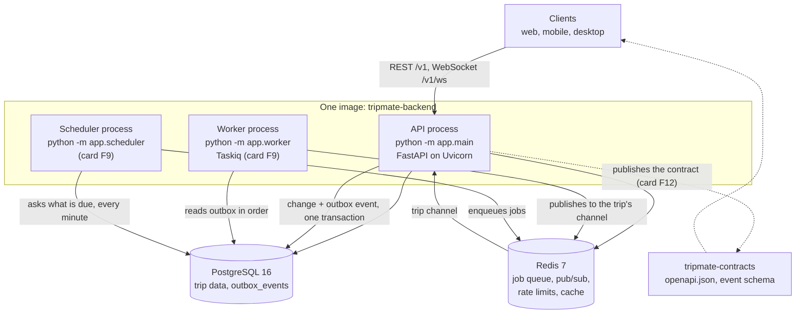

# tripmate-backend

The TripMate backend: one FastAPI codebase and one container image that runs three
processes (the **API**, the **worker**, and the **scheduler**), plus the Alembic
**migrations**. TripMate is a collaborative trip-planning product; this repository
holds only its server code.

Status: EPIC-11 (platform foundation) is in progress. Cards **F1** (skeleton and health
check), **F2** (CI), **F3** (database session and migrations), and **F14** (flow checks
and agent roles) are merged. The rest is planned and marked as such below.

## Where the documents live

The product documents live in the sibling repository `../tripmate-docs` (cloned side by
side) and are never copied here. This README summarises and links; the documents own the
design.

| Document | Holds |
|----------|-------|
| [architecture.md](https://github.com/huynguyennang-agilityio/tripmate-docs/blob/main/docs/architecture.md) | Containers (section 3), backend modules (4), outbox (5.2), hosting (9), background work (10), repositories (11) |
| [development-flow.md](https://github.com/huynguyennang-agilityio/tripmate-docs/blob/main/docs/development-flow.md) | How a card is built, risk levels, the four agents |
| [test-strategy.md](https://github.com/huynguyennang-agilityio/tripmate-docs/blob/main/docs/test-strategy.md) | Test levels |
| [api-design.md](https://github.com/huynguyennang-agilityio/tripmate-docs/blob/main/docs/api-design.md) | The API, error format, events |
| [data-model.md](https://github.com/huynguyennang-agilityio/tripmate-docs/blob/main/docs/data-model.md) | Tables |
| [EPIC-11 spec](https://github.com/huynguyennang-agilityio/tripmate-docs/blob/main/docs/specs/epic-11/spec.md) | The platform foundation this repository is building now |

Repository rules, setup, commands, and conventions are in [CLAUDE.md](CLAUDE.md). The
tasks of EPIC-11 are in [tasks/EPIC-11.md](tasks/EPIC-11.md).

## Architecture

Short version of [architecture.md, section 3](https://github.com/huynguyennang-agilityio/tripmate-docs/blob/main/docs/architecture.md#3-containers).
One image, three commands. PostgreSQL is the only source of truth; Redis holds what can be
rebuilt.



| Process | Does | Built today |
|---------|------|-------------|
| API | Serves `/v1` (today `GET /v1/health`), one database transaction per request | Yes (F1, F3) |
| Worker | Starts, checks settings, scans modules, waits; becomes the Taskiq worker in F9 | Skeleton only |
| Scheduler | Same skeleton; finds due work in PostgreSQL and enqueues it in F9 | Skeleton only |
| Migrations | `python -m alembic upgrade head`; one migration so far (`0001_initial`) | Yes (F3) |

### Modules and platform

The backend is a modular monolith ([architecture.md, section 4](https://github.com/huynguyennang-agilityio/tripmate-docs/blob/main/docs/architecture.md#4-backend-modules)).

- **Modules** (`app/<module>/`, planned by later epics: `identity`, `trips`, `decisions`,
  `itinerary`, `money`, and others) follow one shape: `api.py` (with a `router`),
  `schemas.py`, `service.py`, rule files, `repository.py`, `models.py`, `jobs.py`,
  `events.py`. **No module exists yet**; EPIC-11 builds the platform they plug into.
- **Discovery:** `app/` is scanned at start-up (`app/platform/modules.py`). A module's
  `router` is served under `/v1`; its jobs, event handlers, due-work queries, and error
  codes go through `register(registry)`. A new module changes no shared file.
- **Boundaries** (enforced by `lint-imports`): a module imports another module's
  `service.py` only, modules have no import cycles, `app.platform` imports no module, and
  `flowchecks` imports nothing of the app.
- **Platform** (`app/platform/`) is shared by every module:

| Part | File | State |
|------|------|-------|
| Settings, checked at start-up | `config.py` | Built (F1) |
| Module scanning | `modules.py` | Built (F1) |
| Health check | `health.py` | Built (F1) |
| Redis client | `redis_client.py` | Built (F1) |
| Database engine, session, transaction per request | `db.py` | Built (F3) |
| Errors and error codes | `errors.py` | Interface only, card F4 |
| Access declaration and token check | `access.py` | Interface only, card F5 |
| Rate limits | `rate_limits.py` | Interface only, card F6 |
| Idempotency keys | `idempotency.py` | Interface only, card F7 |
| Outbox | `outbox.py` | Interface only, card F8 |
| Jobs, worker, scheduler, cleanup | `jobs.py`, `process.py` | Interface only, card F9 |
| Logs, traces, metrics, error reporting | `logging.py` | Interface only, card F10 |

Events (planned, F8): a change and its outbox rows commit in one transaction; the worker
reads the outbox in order and publishes each event to the trip's Redis channel, so a client
hears of a change only after it is committed
([architecture.md, section 5.2](https://github.com/huynguyennang-agilityio/tripmate-docs/blob/main/docs/architecture.md#52-events-and-the-outbox)).

## Code structure

```text
tripmate-backend/
├── app/                      The application
│   ├── main.py               API process (python -m app.main)
│   ├── worker.py             Worker process (python -m app.worker)
│   ├── scheduler.py          Scheduler process (python -m app.scheduler)
│   └── platform/             Shared by every module; imports no module
│       ├── config.py         Settings from environment variables, checked once
│       ├── modules.py        Scans app/ and registers each module
│       ├── db.py             Async engine, models' base, transaction per request
│       ├── health.py         GET /v1/health
│       ├── redis_client.py   Redis connection
│       ├── process.py        Signal handling shared by worker and scheduler
│       └── errors.py, access.py, rate_limits.py, idempotency.py, outbox.py,
│           jobs.py, logging.py    Interfaces that cards F4 to F10 fill
├── migrations/               Alembic environment and versions/ (0001_initial)
├── flowchecks/               The four flow checks (failing_first, test_lock, mutation, risk_gate) and the requirements report
├── tests/
│   ├── unit/                 Unit and property tests (no services); unit/flow tests the checks, unit/hooks the hooks
│   ├── integration/          Tests against real PostgreSQL and Redis
│   ├── api/                  API tests over HTTP
│   ├── builders/             Test data builders
│   ├── conftest.py, support.py   Fixtures and helpers
│   └── INTERFACE.md          What the tests need from the code, card by card
├── .github/
│   ├── workflows/            ci.yml, flow.yml, flow-checks.yml, risk-gate.yml, risk-gate-check.yml
│   └── risk-paths.toml       Risk level of each path (High, Medium, Low)
├── .claude/
│   ├── agents/               The four agent roles of a card
│   ├── hooks/                Claude Code hooks: bash_guard, file_guard, python_format
│   └── settings.json         Registers the hooks for every machine
├── tasks/                    EPIC-11.md (the cards) and EPIC-11-notes/ (review round 2)
├── docker/postgres-init/     Creates the tripmate_test database on first start
├── compose.yaml              Local PostgreSQL 16 and Redis 7
├── Dockerfile                The one image for the three processes
├── alembic.ini               Alembic configuration
├── pyproject.toml            Dependencies and tool settings (ruff, mypy, pytest, mutmut, import-linter)
├── uv.lock                   Locked versions
├── .python-version           Python version (3.13)
├── .env.example              Every setting, no value
└── CLAUDE.md                 Rules and conventions for this repository
```

## Technical stack

Resolved versions are from `uv.lock`; the constraint column is what `pyproject.toml`
asks for (blank means any version, pinned by the lock file).

### Runtime

| Component | Resolved | Constraint |
|-----------|----------|------------|
| Python | 3.13 (`.python-version`; image `python:3.13-slim`) | `>=3.13,<3.14` |
| uv | 0.13.7 (Dockerfile, CI) | -- |
| FastAPI | 0.165.0 | `<1` |
| Starlette | 1.10.0 | via FastAPI |
| Uvicorn | 0.54.0 (`standard` extra) | -- |
| Pydantic | 2.14.4 | `>=2,<3` |
| SQLAlchemy (asyncio) | 2.1.9 | `>=2,<3` |
| asyncpg | 0.32.0 | -- |
| Alembic | 1.20.1 | -- |
| Redis client (`redis`) | 8.2.0 | -- |
| Taskiq | 0.13.0 | `<1` |
| taskiq-redis | 1.2.4 | -- |
| structlog | 26.1.0 | -- |
| OpenTelemetry API and SDK | 1.45.2 | -- |
| OpenTelemetry OTLP HTTP exporter | 1.45.2 | -- |
| OpenTelemetry instrumentation (fastapi, sqlalchemy, redis) | 0.66b2 | -- |
| sentry-sdk | 3.0.0 | `>=3,<4` |
| PyJWT (`crypto` extra) | 2.15.1 | -- |
| argon2-cffi | 25.1.0 | -- |
| PostgreSQL | 16 (`postgres:16` in compose and CI) | -- |
| Redis server | 7 (`redis:7` in compose and CI) | -- |

### Development and quality

| Tool | Resolved | Used for |
|------|----------|----------|
| pytest | 9.2.0 | Test runner |
| pytest-asyncio | 1.5.0 | Async tests (`asyncio_mode = "auto"`) |
| Hypothesis | 6.170.17 | Property tests |
| schemathesis | 4.34.0 | API contract tests |
| httpx | 0.28.1 | HTTP client in tests |
| mutmut | 3.8.1 | Mutation testing of rule files |
| ruff | 0.17.6 | Lint and format (line length 100) |
| mypy | 2.4.1 | Types, strict mode, pydantic plugin |
| import-linter | 2.17 | Module boundaries |
| pip-audit | 2.10.1 | Known vulnerabilities in locked dependencies |
| gitleaks | 8.30.1 | Secret scan in CI (downloaded, checksum checked) |

### CI action pins

| Action | Version | Pin |
|--------|---------|-----|
| `actions/checkout` | v7.0.1 | `3d3c42e5aac5ba805825da76410c181273ba90b1` |
| `astral-sh/setup-uv` | v10.4.0 | `1db35dd8eee11c5894872e0b383ae6c406cf738d` |

Third-party actions are pinned to a full commit SHA with the version in a comment.

## Getting started

```bash
# 1. Clone next to the documents
#    tripmate/tripmate-docs and tripmate/tripmate-backend

# 2. Install Python 3.13 and uv, then the locked dependencies
uv sync

# 3. Start PostgreSQL and Redis (use POSTGRES_HOST_PORT=5433 when 5432 is taken)
docker compose up -d

# 4. Run the tests (the database name must end in _test)
TEST_DATABASE_URL=postgresql+asyncpg://tripmate@127.0.0.1:5432/tripmate_test \
TEST_REDIS_URL=redis://127.0.0.1:6379/0 \
uv run pytest tests -q

# 5. Lint, types, boundaries
uv run ruff check . && uv run ruff format --check .
uv run mypy app flowchecks
uv run lint-imports
```

- Unit tests need no services: `uv run pytest tests/unit -q`.
- Settings come from environment variables only; `.env.example` lists them. Never commit
  a `.env` or a secret: the repository is public.
- More detail: [CLAUDE.md](CLAUDE.md), sections "Setup" and "Commands".
- Claude Code sessions in this repository run three hooks (blocked commands, secret guard, ruff on save); see [CLAUDE.md](CLAUDE.md), section "Claude Code hooks".

## CI and flow checks

Fourteen checks are required on `main`: ten in `ci.yml` and four flow checks. The rules
and exact behaviour are in [CLAUDE.md](CLAUDE.md), sections "CI" and "Flow checks".

| Check | What it enforces |
|-------|------------------|
| `lint` | ruff check and format |
| `types` | mypy strict on `app` and `flowchecks` |
| `unit` | Unit and property tests |
| `integration` | Integration and API tests on PostgreSQL 16 and Redis 7 |
| `requirements` | Every P0 ID in `tests/requirement-ids.txt` has a test that ran; no test is named with an unlisted ID |
| `imports` | Module boundaries (import-linter) |
| `migrations` | One Alembic head, upgrade works, models match migrations |
| `audit` | pip-audit on locked dependencies |
| `secrets` | gitleaks on the commits and the files |
| `image` | The Docker image builds |
| `flow / failing-first` | A test added by a test commit fails before the code exists |
| `flow / test-lock` | No later commit changes, skips, or deletes a locked test |
| `flow / mutation` | Rule files have no unexplained surviving mutant |
| `gate / risk-gate` | A High path changed only with the `human-approved` label (the product owner adds it) |

## How a card is built

Each card runs with four agents in `.claude/agents/`: `test-agent` writes the tests first,
`code-agent` makes them pass and opens the pull request, `test-check-agent` reviews the
tests, and `diff-review-agent` reviews the diff. Branches are `<type>/<ID>-<short-name>`;
the test commit carries the trailer `Agent: test`. The full flow, risk levels, and
review rounds are in
[development-flow.md](https://github.com/huynguyennang-agilityio/tripmate-docs/blob/main/docs/development-flow.md),
section 2.3, and a summary is in [CLAUDE.md](CLAUDE.md), section "How a card is built".

## Hosting plan

Production runs on Render, Singapore region
([architecture.md, section 9](https://github.com/huynguyennang-agilityio/tripmate-docs/blob/main/docs/architecture.md#9-deployment-and-operations)).
Until the beta it is small: one instance on the free plan runs the API, the worker, and
the scheduler together, with free Render Postgres and Key Value plans, and migrations as
the pre-deploy step (`render.yaml`). Card F11 builds this; see the
[EPIC-11 spec](https://github.com/huynguyennang-agilityio/tripmate-docs/blob/main/docs/specs/epic-11/spec.md),
section 2.8, and [tasks/EPIC-11.md](tasks/EPIC-11.md), card F11. Nothing is deployed yet.
